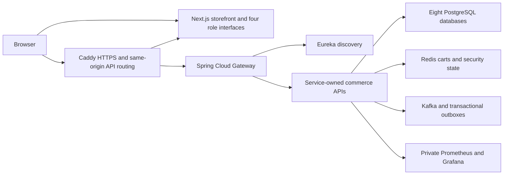

# OrderFlow

A full-stack microservices commerce portfolio with a Next.js storefront, vendor workspace, delivery-agent workspace and administration dashboard. The application and Maven project live in [`orderflow/`](orderflow/README.md).

**Live demo: not deployed.** AWS account access, an owned domain and explicit approval for the reviewed billable resource plan are required before deployment. **Demo payments charge no real money; email and SMS are simulated.**

Phase 10 infrastructure and release tooling are implemented locally. The Spring Boot 4.1.2 / Spring Cloud 2025.1.4 migration passes the unchanged dependency security gate. Full-stack acceptance on a sufficiently provisioned host remains pending; see the [current migration and verification report](orderflow/docs/boot4-migration-2026-10-27.md). AWS deployment has not occurred.

## Architecture



The frontend uses React, strict TypeScript, Tailwind, TanStack Query, React Hook Form/Zod and exact monetary handling. Access tokens stay in memory, refresh cookies remain backend-owned, and role interfaces use authenticated gateway APIs. The backend uses Java21, Spring Boot3.5/Spring Cloud2025, RS256 JWT, CSRF, Redis revocation, Flyway, Kafka, idempotent consumers, transactional outboxes and bounded scheduling/reconciliation. Payments/refunds and delivery fulfillment remain distinct state machines.

## Development and Docker

Use Java21, Node22 and Docker Compose. Frontend defaults to localhost:3000 and the gateway to localhost:8080.

```sh
cd orderflow
./mvnw -B -ntp clean verify
cp .env.example .env
# Review local-only values before startup.
docker compose --profile frontend up -d --build

cd frontend
npm ci
npm run lint
npm run typecheck
npm test
npm run build
```

See [frontend setup and roles](orderflow/frontend/README.md), [backend architecture/startup](orderflow/README.md) and [Phase9 verification](orderflow/frontend/docs/phase9-verification.md). Existing developer databases/volumes must be preserved; stopping or replacing containers is not permission to delete their data.

## AWS deployment and CI/CD

[Phase10 deployment guide](orderflow/docs/phase-10-cloud-deployment.md) describes a configurable single Ubuntu EC2 host, encrypted persistent EBS, private Compose services behind Caddy, twelve immutable ECR repositories, scoped IAM/SSM, GitHub OIDC, external or authorized Route53 DNS, backups and optional monitoring. This affordable portfolio architecture has single points of failure and may require planned release downtime.

[Terraform](orderflow/infrastructure/terraform/README.md) can be formatted, initialized without a backend and validated locally. Real plans/apply, DNS changes, image publication and production deployment require the appropriate access and explicit authorization. The [cost worksheet](orderflow/docs/cloud-cost-management.md) contains an illustrative estimate and unverified/additional costs; budget alerts are not spending caps.

Root GitHub Actions preserve backend/frontend quality gates, validate infrastructure and workflows, publish exact-SHA/digest images through an approved OIDC environment, and deploy only through a manually approved environment. [Release and rollback tooling](orderflow/docs/cloud-ci-cd.md) validates account/schema/artifact identity, backups, readiness, HTTPS, authentication and critical workflows before recording a release healthy. Rollback never restores old database records automatically.

## Monitoring, screenshots and limitations

[Monitoring](orderflow/docs/cloud-monitoring.md) covers all eleven Java services, private frontend/proxy availability, host resources, business/outbox/DLT metrics and bounded logs. Grafana administration and Prometheus remain private; application ADMIN permissions do not grant direct infrastructure administration.

The browser suites generate desktop/mobile role screenshots under `orderflow/frontend/output/playwright/` after actual verification. These local artifacts are ignored and contain synthetic test data. Public-demo screenshots and an actual live URL should be added only after an authorized deployed HTTPS journey passes.

Read the [deployment readiness report](orderflow/docs/phase-10-readiness.md) for exact PASS/FAIL/NOT RUN results. Public AWS reachability, ACME certificate trust, real OAuth/provider integrations, enterprise HA, production-scale capacity and measured disaster-recovery times must not be inferred from local tests. Simulator-backed payments are not real commerce or PCI compliance.
