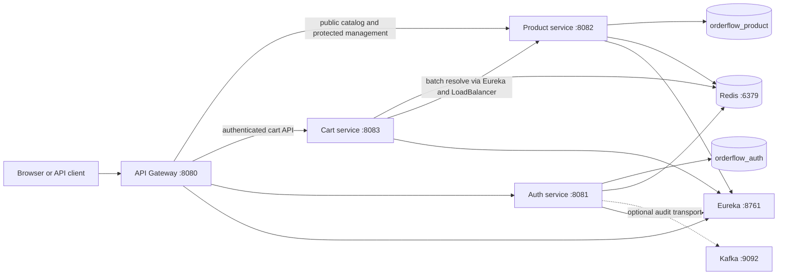

# OrderFlow

OrderFlow is a Java 21 and Spring Boot microservice platform. Phase 3 adds a
vendor-owned product catalog, Redis-backed public catalog caching, and atomic
shopping carts while preserving the Phase 1 platform and Phase 2 authentication
foundation.

## Architecture



Every protected service independently validates RS256 access tokens, issuer,
expiry, required claims, revoked `jti` values, and the user's current token
version. Ownership comes from the JWT subject. Client-supplied identity headers
are stripped by the gateway and never determine product or cart ownership.

## Modules and ports

| Module | Port | Responsibility |
| --- | ---: | --- |
| `platform-contracts` | — | Shared `ApiError`, error codes, and correlation contracts |
| `service-registry` | 8761 | Eureka registry |
| `api-gateway` | 8080 | Reactive routing, JWT security, CSRF, CORS, safe errors |
| `auth-service` | 8081 | Users, credentials, roles, JWTs, refresh sessions, OAuth2 |
| `product-service` | 8082 | Categories, vendor products, lifecycle, search, Redis caching |
| `cart-service` | 8083 | JWT-owned Redis carts, Lua mutations, product snapshot validation |

PostgreSQL is exposed on 5432, Redis on 6379, and Kafka's host listener on 9092.

## Product catalog

New products begin in `DRAFT`. A vendor may manage only products whose
`vendorId` equals the JWT subject; an administrator may manage any product.
Activation requires a valid non-archived product and an active category.
`INACTIVE` products can be reactivated, while `ARCHIVED` is a permanent normal
API transition. Public reads return only `ACTIVE` products in `ACTIVE`
categories. A vendor querying another vendor's private management resource gets
404; explicit role denial gets 403.

Categories are administrator-managed. The migration seeds stable Electronics,
Books, Home and Kitchen, and Clothing UUIDs. A category containing active
products cannot be deactivated and returns `CATEGORY_IN_USE`.

Public endpoints:

| Method | Path | Notes |
| --- | --- | --- |
| GET | `/api/products` | Search, category/price/currency filters, allowlisted sort, bounded paging |
| GET | `/api/products/{id}` | Publicly visible product only |
| GET | `/api/products/slug/{slug}` | Publicly visible product only |
| GET | `/api/categories` | Active categories |
| GET | `/api/categories/{slug}/products` | Public products in an active category |

Protected endpoints:

| Access | Endpoints |
| --- | --- |
| Any authenticated user | `POST /api/products/resolve`, all `/api/cart/**` |
| `VENDOR` or `ADMIN` | all `/api/vendor/products/**` |
| `ADMIN` | all `/api/admin/categories/**` and `/api/admin/products/**` |

The resolution API accepts at most 100 product IDs and uses one batch database
query. It reports purchasability without exposing vendor-private fields or
inventing inventory. Stock and reservations intentionally remain Phase 4 work.

Product data lives in the separate logical database `orderflow_product`;
authentication data remains in `orderflow_auth`. Compose can host both on one
PostgreSQL server for local efficiency. An idempotent bootstrap container also
creates or repairs the product role/database for existing Phase 2 volumes.

Public detail, slug, search, and category results use JSON Redis caches. Keys
are under `orderflow:catalog:v1`, nulls are not cached, and default TTLs are
five minutes for details/slugs, two minutes for searches, and ten minutes for
categories. Every catalog mutation increments the exact `catalog:version` key.
Search and category keys include that version, providing broad invalidation
without `KEYS`, scans, or cache-key enumeration. Targeted product caches are
evicted directly. Redis cache failures are logged safely; PostgreSQL reads and
committed writes remain authoritative. Product readiness therefore includes
PostgreSQL but deliberately excludes optional Redis caching.

## Shopping cart

Cart ownership is always the JWT subject. The service accepts no user ID in a
path, query, request body, or client identity header. A cart is a namespaced
Redis hash at `orderflow:cart:{subject}` with reserved metadata fields and one
JSON item field per product. It never contains access tokens, cookies, or
refresh credentials.

Add, quantity update, remove, and validation replacement use Redis Lua scripts.
They atomically enforce currency consistency, quantity and distinct-item limits,
version increments, timestamps, and TTL refresh. The defaults are 100 distinct
products, quantity 1–99 per product, and a rolling 30-day TTL. Removing the last
item deletes the key; reading a missing cart returns an empty HTTP 200 response.

Each item stores a product name, price, currency, and product-version snapshot.
This keeps stored carts readable while product-service is unavailable.
`POST /api/cart/validate` resolves all IDs in one request, refreshes snapshots,
marks unavailable products without deleting them, and reports
`PRICE_CHANGED`/`PRODUCT_UNAVAILABLE`. Checkout in Phase 4 must repeat
authoritative product and inventory validation.

Cart-to-product requests use `http://PRODUCT-SERVICE` through Eureka and Spring
Cloud LoadBalancer. Authorization and the existing correlation ID are
propagated, while cookies are removed. Configured connection/read timeouts,
Resilience4j retry, and a circuit breaker protect temporary connection,
timeout, 502, 503, and 504 failures only. Stored cart reads make no product call.
Mutations or validation return safe `PRODUCT_SERVICE_UNAVAILABLE` errors when
resolution cannot be trusted. Cart readiness includes Redis but not
product-service.

## Build, test, and run

Prerequisites are a Java 21-compatible JDK, Docker Engine with Compose v2,
Bash, and `curl`. Docker must be available for the PostgreSQL and Redis
Testcontainers integration suites.

```bash
./mvnw -B clean verify
docker compose config
./scripts/dev-up.sh
./scripts/smoke-test.sh
./scripts/dev-down.sh
```

Focused verification:

```bash
./mvnw -B -pl product-service -am verify
./mvnw -B -pl cart-service -am verify
./mvnw -B -pl api-gateway -am test
```

The smoke test preserves Phase 1/2 checks, creates a local vendor through a
database-only role promotion, exercises product lifecycle and public caching,
uses a separate customer cart, detects a price change, checks authorization and
correlation propagation, and never prints tokens.

## Configuration and secrets

`.env.example` contains local placeholders only. Never commit `.env`, cookie
jars, copied JWTs, OAuth secrets, passwords, private keys, keystores, or PEM key
material. Docker's ephemeral RSA keys are local-development behavior only;
production must mount protected keys and disable ephemeral generation.

Important Phase 3 variables:

| Variables | Purpose |
| --- | --- |
| `PRODUCT_POSTGRES_HOST`, `PRODUCT_POSTGRES_PORT`, `PRODUCT_POSTGRES_DB` | Product-owned database location |
| `PRODUCT_POSTGRES_USER`, `PRODUCT_POSTGRES_PASSWORD` | Product database credential |
| `REDIS_HOST`, `REDIS_PORT`, `REDIS_PASSWORD` | Shared server with namespaced data |
| `EUREKA_DEFAULT_ZONE` | Service discovery endpoint |
| `APP_AUTH_JWK_SET_URI`, `APP_JWT_ISSUER` | Independent JWT validation |
| `APP_CATALOG_DEFAULT_CURRENCY`, `APP_CATALOG_SUPPORTED_CURRENCIES` | Catalog currency policy |
| `APP_CATALOG_MAX_PAGE_SIZE` | Public/vendor page bound |
| `APP_CATALOG_PRODUCT_CACHE_TTL`, `APP_CATALOG_SEARCH_CACHE_TTL`, `APP_CATALOG_CATEGORY_CACHE_TTL` | Cache TTLs |
| `APP_CART_TTL`, `APP_CART_MAX_DISTINCT_ITEMS`, `APP_CART_MAX_QUANTITY_PER_ITEM` | Cart expiration and limits |
| `APP_PRODUCT_CLIENT_CONNECT_TIMEOUT`, `APP_PRODUCT_CLIENT_READ_TIMEOUT` | Cart downstream timeouts |

All handled failures use the shared `ApiError` and preserve
`X-Correlation-ID`. Health, liveness, readiness, info, metrics, and Prometheus
are exposed; secret-bearing actuator endpoints are not.

Detailed design:

- [Phase 3 product and cart](docs/phase-3-product-cart.md)
- [Product catalog](docs/product-catalog.md)
- [Redis caching](docs/redis-caching.md)
- [Cart consistency](docs/cart-consistency.md)
- [Phase 2 authentication](docs/phase-2-authentication.md)
- [JWT and key management](docs/jwt-and-key-management.md)
- [API error contract](docs/api-error-contract.md)

## Phase 4 preview

Phase 4 can add inventory authority, reservations, checkout, orders, and Kafka
business events without moving Phase 3 data or weakening service boundaries.
It must revalidate cart product snapshots and obtain authoritative inventory
before order creation. Payments, delivery, notifications, coupons, reviews,
recommendations, and product media remain outside Phase 3.
