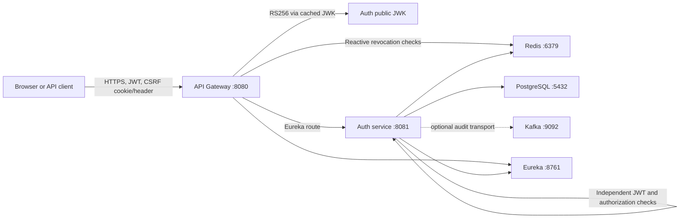

# OrderFlow

OrderFlow is a Java 21/Spring microservice learning platform. Phase 2 extends the
Phase 1 runtime with registration, login, RSA-signed access tokens, opaque
rotating refresh tokens, logout and logout-all revocation, role authorization,
CSRF protection, login throttling, and optional Google/GitHub OAuth2 login.
Products, carts, inventory, orders, payments, delivery, notifications, and
analytics remain intentionally deferred.

## Architecture



The gateway removes client-supplied identity headers, validates RS256 tokens,
issuer, expiry, roles, revoked `jti` values, and user token versions, then routes
to the MVC auth service. The auth service independently repeats token,
revocation, and method-level role checks; downstream identity is derived from
the JWT, never from request parameters or identity headers.

## Modules

| Module | Purpose |
| --- | --- |
| `platform-contracts` | Shared `ApiError`, error codes, and correlation contracts |
| `service-registry` | Eureka registry and operational endpoints |
| `api-gateway` | Reactive routing, JWT/JWK validation, Redis revocation, CORS, and safe errors |
| `auth-service` | Users, OAuth accounts, credentials, tokens, sessions, roles, and audit events |

## Prerequisites and commands

- Java 21-compatible JDK
- Docker Engine with Compose v2
- Bash and `curl`

```bash
./mvnw clean verify
docker compose config
./scripts/dev-up.sh
./scripts/smoke-test.sh
./scripts/dev-down.sh
```

Maven Wrapper is committed. `*IT` tests use isolated PostgreSQL/Redis/Kafka
Testcontainers and do not depend on a running Compose stack. `smoke-test.sh`
preserves Phase 1 checks and adds registration, JWT structure, `/me`, secure
ping, customer/admin authorization, refresh rotation/reuse rejection, logout,
access revocation, and correlation checks. It never prints full tokens.

## Authentication flows

Registration normalizes the email, enforces a 12–128-character password policy,
hashes it with BCrypt cost 12, assigns only `CUSTOMER`, creates a Redis refresh
session, and returns a 10-minute access token plus an HttpOnly refresh cookie.
Login uses equivalent generic behavior for unknown email and wrong password and
applies an atomic Redis attempt limit.

Access tokens use RS256 and carry `iss`, `sub`, `iat`, `exp`, `jti`, `email`,
`roles`, `session_id`, and `token_version`. Refresh tokens contain at least 256
random bits; only their SHA-256 hashes and safe session metadata are stored.
Every refresh rotates the token atomically. Reuse of a rotated token revokes the
whole family. Logout revokes the refresh token and blacklists the access `jti`;
logout-all also increments the persistent user token version and revokes every
session.

Browser writes require the `XSRF-TOKEN` cookie value in `X-XSRF-TOKEN`. The
refresh credential remains in a separate HttpOnly cookie. Call
`GET /api/auth/csrf` before registration, login, refresh, logout, logout-all, or
OAuth code exchange.

OAuth2 is inactive by default. With the `oauth2` profile and provider
credentials, Spring Security enforces provider state. Google and GitHub emails
must be trustworthy and verified; GitHub's primary verified email is retrieved
from its email API. A successful callback redirects with only a single-use,
60-second exchange code. OrderFlow access or refresh tokens never appear in the
redirect URL.

## Key endpoints

| Method | Path | Access |
| --- | --- | --- |
| GET | `/api/auth/csrf` | Public |
| POST | `/api/auth/register` | Public + CSRF |
| POST | `/api/auth/login` | Public + CSRF |
| POST | `/api/auth/refresh` | Refresh cookie + CSRF |
| POST | `/api/auth/logout` | Bearer + CSRF |
| POST | `/api/auth/logout-all` | Bearer + CSRF |
| GET | `/api/auth/me` | Bearer |
| GET | `/api/auth/.well-known/jwks.json` | Public key material only |
| POST | `/api/auth/oauth2/exchange` | One-time code + CSRF |
| GET | `/api/security/authenticated` | Any authenticated user |
| GET | `/api/security/customer` | `CUSTOMER` or `ADMIN` |
| GET | `/api/security/admin` | `ADMIN` |
| GET | `/api/platform/ping` and `/info` | Public Phase 1 endpoints |
| GET | `/api/platform/secure-ping` | Bearer |

## Curl example

The smoke script is the executable reference. A minimal local sequence is:

```bash
curl -sS -c cookies.txt http://localhost:8080/api/auth/csrf > csrf.json
# Read the JSON "token" value without printing credentials in shared logs.
curl -sS -b cookies.txt -c cookies.txt \
  -H 'Content-Type: application/json' \
  -H "X-XSRF-TOKEN: ${CSRF_TOKEN}" \
  --data '{"email":"customer@example.com","password":"A long local password!","displayName":"Customer"}' \
  http://localhost:8080/api/auth/register
```

Do not commit `cookies.txt`, copied tokens, `.env`, private PEM files, or provider
credentials.

## Configuration and secrets

`.env.example` contains local placeholders only; `.env` is ignored. Local
Compose explicitly generates one ephemeral RSA-2048 key pair per auth-service
process. Restarting it invalidates existing tokens. Production must set
`APP_JWT_ALLOW_EPHEMERAL_KEYS=false`, mount protected PKCS#8 private and X.509
public PEM files, and set `APP_AUTH_REFRESH_COOKIE_SECURE=true`.

| Variable | Local default | Purpose |
| --- | --- | --- |
| `APP_JWT_ISSUER` | `https://orderflow.local` | Exact token issuer in both services |
| `APP_JWT_KEY_ID` | `orderflow-docker-local` | JWK/JWT key identifier |
| `APP_JWT_ACCESS_TOKEN_TTL` | `10m` | Access-token lifetime |
| `APP_JWT_ALLOW_EPHEMERAL_KEYS` | Docker only: `true` | Explicit local key generation |
| `APP_JWT_PRIVATE_KEY_LOCATION` | empty | Production PKCS#8 PEM resource |
| `APP_JWT_PUBLIC_KEY_LOCATION` | empty | Production X.509 PEM resource |
| `APP_AUTH_JWK_SET_URI` | auth service JWK URL | Gateway validation source |
| `APP_AUTH_REFRESH_TOKEN_TTL` | `14d` | Refresh session lifetime |
| `APP_AUTH_REFRESH_COOKIE_NAME` | `ORDERFLOW_REFRESH` | HttpOnly cookie name |
| `APP_AUTH_REFRESH_COOKIE_SECURE` | local `false` | Must be `true` behind production HTTPS |
| `APP_AUTH_REFRESH_COOKIE_SAME_SITE` | `Strict` | Cookie cross-site policy |
| `APP_AUTH_LOGIN_MAX_ATTEMPTS` | `5` | Login threshold |
| `APP_AUTH_LOGIN_ATTEMPT_WINDOW` | `15m` | Attempt counter TTL |
| `GOOGLE_CLIENT_ID`, `GOOGLE_CLIENT_SECRET` | empty | Optional OAuth profile |
| `GITHUB_CLIENT_ID`, `GITHUB_CLIENT_SECRET` | empty | Optional OAuth profile |
| `APP_BOOTSTRAP_ADMIN_ENABLED` | `false` | Explicit local-only admin bootstrap |

Database, Redis, Kafka, Eureka, redirect, and port variables are documented in
`.env.example`. No administrator is created by default. When the optional
bootstrap is enabled, all values are required and the same password policy and
BCrypt hashing apply. Production administration should use a dedicated
provisioning process.

## Operations and security notes

Health, liveness, readiness, info, and Prometheus endpoints remain available.
Auth readiness includes PostgreSQL, Redis, Flyway completion, and Spring
readiness; optional Kafka audit delivery does not block login. Gateway readiness
includes Redis because protected authorization fails closed when revocation
state cannot be checked. Environment and bean-dump actuator endpoints are not
exposed.

All handled failures use the shared `ApiError` and preserve
`X-Correlation-ID`. Request logs and security audit events exclude passwords,
authorization headers, cookies, tokens, OAuth provider tokens, raw IP addresses,
and key material. Audit output is structured logging; Kafka remains a
noncritical future transport.

Current limitations: local ephemeral keys are not suitable for multi-replica
deployments, key rotation is not automated, account recovery/MFA/email
verification/password creation for OAuth-only users are deferred, and provider
end-to-end login requires real credentials and provider configuration.

Detailed design:

- [Phase 2 authentication](docs/phase-2-authentication.md)
- [JWT and key management](docs/jwt-and-key-management.md)
- [Refresh-token security](docs/refresh-token-security.md)
- [OAuth2 login](docs/oauth2-login.md)
- [API error contract](docs/api-error-contract.md)

## Phase 3 preview

Phase 3 can build business services on these identity and authorization
boundaries. Products, carts, inventory, orders, payments, delivery,
notifications, and analytics are not implemented in Phase 2.
