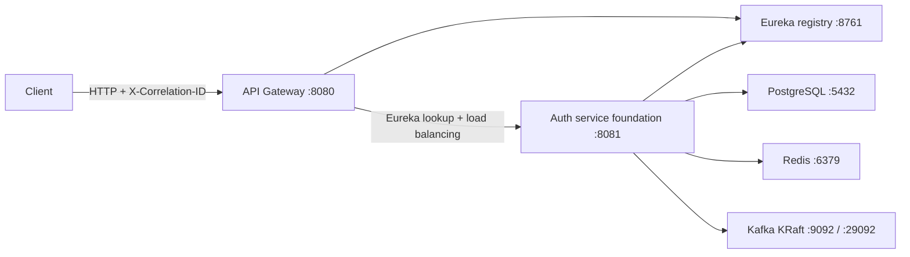

# OrderFlow

OrderFlow is a production-style, event-driven microservices learning platform for
e-commerce and delivery workflows. Phase 1 establishes the runtime, observability,
data, error-handling, and testing foundation on which later business capabilities
can be added.

Phase 1 intentionally contains no users, authentication, authorization, JWT,
OAuth2, roles, products, carts, orders, inventory, payments, delivery,
notifications, or analytics.

## Architecture



The public routes are explicit:

- `/api/platform/**` routes to `AUTH-SERVICE`.
- `/api/auth/**` is reserved for Phase 2 and also routes to `AUTH-SERVICE`.
- Eureka discovery-locator routes are not exposed.

## Modules

| Module | Purpose |
| --- | --- |
| `platform-contracts` | Framework-light error and correlation contracts |
| `service-registry` | Eureka server and operational endpoints |
| `api-gateway` | Reactive routing, correlation, CORS, logging, and safe errors |
| `auth-service` | MVC/JPA infrastructure foundation and platform diagnostics |

Only these four modules participate in the Maven reactor.

## Prerequisites

- A Java 21-compatible JDK (the compiler is configured with `release=21`)
- Docker Desktop or another Docker Engine with Compose v2
- `curl`
- Bash

Maven does not need to be installed; the repository contains Maven Wrapper.
Docker must be running for Testcontainers and the full stack.

The requested Spring Cloud version `2025.0.2.1` is not published in Maven
Central. This build uses the released, Spring Boot 3.5-compatible `2025.0.2` BOM;
see the root POM comment.

## Ports

| Component | Host port | Container address |
| --- | ---: | --- |
| API Gateway | 8080 | `api-gateway:8080` |
| Auth service | 8081 | `auth-service:8081` |
| Eureka dashboard | 8761 | `service-registry:8761` |
| PostgreSQL | 5432 | `postgres:5432` |
| Redis | 6379 | `redis:6379` |
| Kafka external listener | 9092 | `localhost:9092` |
| Kafka internal listener | — | `kafka:29092` |

## Environment

Copy `.env.example` to `.env` only for local overrides. `.env` files are ignored.
The committed password is explicitly a local-development default, not a secret.

| Variable | Default | Used by |
| --- | --- | --- |
| `POSTGRES_HOST` | `localhost` (`postgres` in Docker) | Auth service |
| `POSTGRES_PORT` | `5432` | Auth service / Compose |
| `POSTGRES_DB` | `orderflow_auth` | PostgreSQL / Auth service |
| `POSTGRES_USER` | `orderflow` | PostgreSQL / Auth service |
| `POSTGRES_PASSWORD` | `orderflow_local_password` | Local development only |
| `REDIS_HOST` | `localhost` (`redis` in Docker) | Auth service |
| `REDIS_PORT` | `6379` | Redis / Auth service |
| `REDIS_PASSWORD` | empty | Redis / Auth service |
| `KAFKA_BOOTSTRAP_SERVERS` | `localhost:9092` (`kafka:29092` in Docker) | Auth service |
| `EUREKA_DEFAULT_ZONE` | `http://localhost:8761/eureka/` | Clients |
| `APP_CORS_ALLOWED_ORIGINS` | localhost ports 3000 and 5173 | Gateway |

## Build and test

```bash
./mvnw clean verify
```

This runs unit tests with Surefire and `*IT` integration tests with Failsafe.
`InfrastructureIT` uses PostgreSQL, Redis, and Kafka Testcontainers and disables
Eureka. It is skipped only when no Docker environment is available.

To validate the deployment model separately:

```bash
docker compose config
```

## Run locally

For a complete containerized environment:

```bash
./scripts/dev-up.sh
./scripts/smoke-test.sh
./scripts/dev-down.sh
```

`dev-up.sh` builds all application images, starts the dependencies, waits for
readiness and a successful Eureka-backed gateway route, then prints the service
URLs. `dev-down.sh` retains persistent data.

To run applications from the host instead, first start PostgreSQL, Redis, Kafka,
and Eureka on the host-default ports, then run the desired module with its
default configuration. The `docker` profile switches addresses to Compose
service names.

## Operational URLs

For each application, the following paths are available:

- `/actuator/health`
- `/actuator/health/liveness`
- `/actuator/health/readiness`
- `/actuator/info`
- `/actuator/prometheus`

Examples:

- Gateway health: <http://localhost:8080/actuator/health>
- Auth readiness: <http://localhost:8081/actuator/health/readiness>
- Registry Prometheus metrics: <http://localhost:8761/actuator/prometheus>
- Eureka dashboard: <http://localhost:8761>

Environment and bean-dump actuator endpoints are not exposed. Health details are
not returned to unauthenticated callers. Auth readiness includes PostgreSQL,
Redis, Kafka, and Spring readiness state.

## Correlation IDs

The gateway accepts `X-Correlation-ID` only when the trimmed value is 1–128
characters and contains letters, digits, hyphens, underscores, periods, or
colons. Missing or unsafe values are replaced with a UUID. The final value is:

1. attached to the downstream request;
2. stored in Reactor context at the gateway;
3. stored as a request attribute and in MDC at the MVC service;
4. returned in the response header and response JSON;
5. included in structured request-completion logs.

Headers, cookies, tokens, passwords, and bodies are never included in completion
logs.

## API error contract

All handled API errors use the shared shape:

```json
{
  "timestamp": "2026-07-24T01:00:00Z",
  "status": 404,
  "error": "Not Found",
  "code": "RESOURCE_NOT_FOUND",
  "message": "The requested resource was not found",
  "path": "/unknown",
  "correlationId": "demo-correlation-123",
  "fieldErrors": []
}
```

Client responses never contain stack traces, Java class names, SQL messages, or
raw unexpected exception messages. See
[`docs/api-error-contract.md`](docs/api-error-contract.md).

## Smoke tests

`./scripts/smoke-test.sh` waits with a bounded timeout and verifies all core
health endpoints, Eureka registration, gateway-to-auth routing, the Flyway-backed
metadata endpoint, and both supplied and generated correlation IDs. It uses
`jq` when present and a standard `sed` fallback otherwise.

## Troubleshooting

- **Docker connection fails:** start Docker Desktop and confirm `docker version`
  reports a server.
- **A host port is occupied:** override its variable in a local `.env`, then use
  the same port variable when running smoke tests.
- **Auth readiness is DOWN:** inspect `docker compose logs auth-service` and the
  PostgreSQL, Redis, and Kafka health states with `docker compose ps`.
- **Kafka is slow on first start:** allow the configured startup window; the
  image initializes a single-node KRaft log on its first run.
- **Stale dependency state:** stop the stack, remove only OrderFlow volumes, and
  rebuild:

  ```bash
  ./scripts/clean-environment.sh
  ./scripts/dev-up.sh
  ```

`clean-environment.sh` permanently removes this Compose project's PostgreSQL,
Redis, and Kafka volumes.

## Phase 2 preview

Phase 2 can add users, roles, registration, login, password hashing, JWT access
tokens, refresh tokens, OAuth2 integration, logout, and security rules inside the
existing service and gateway boundaries. None of those domain or security
features are implemented in Phase 1.
