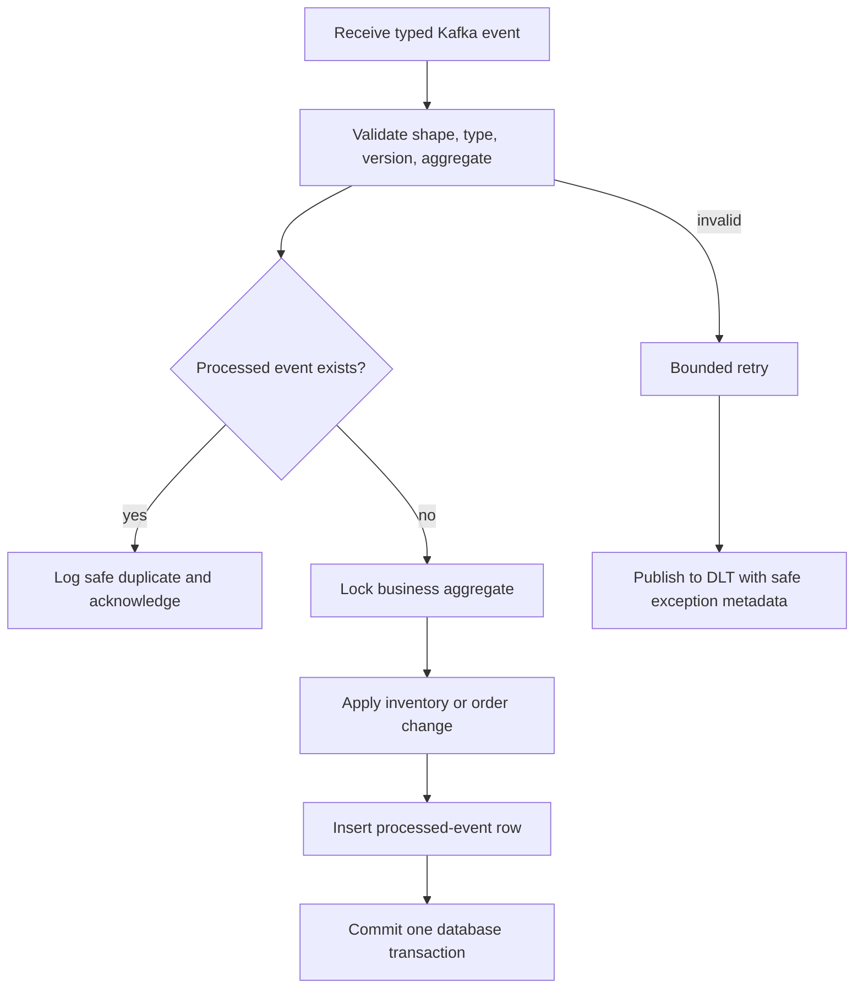

# Idempotent Kafka Consumers

Kafka offsets alone do not prove that a database mutation was applied exactly
once. A process can commit business data and crash before committing its
offset, causing redelivery. Every consumer therefore records the pair
`(eventId, consumerName)` in its own PostgreSQL database.

The uniqueness constraint prevents repeated handling of the same event by the
same logical consumer. Inventory uses separate names for order creation and
cancellation; order-service uses its inventory workflow consumer name. The
business update and processed row commit together.

Duplicate publication, consumer restart, and offset replay therefore do not
reserve/release stock twice or duplicate order history. A permanent validation
failure never creates a processed row; it reaches DLT after bounded retry for
operator inspection.
