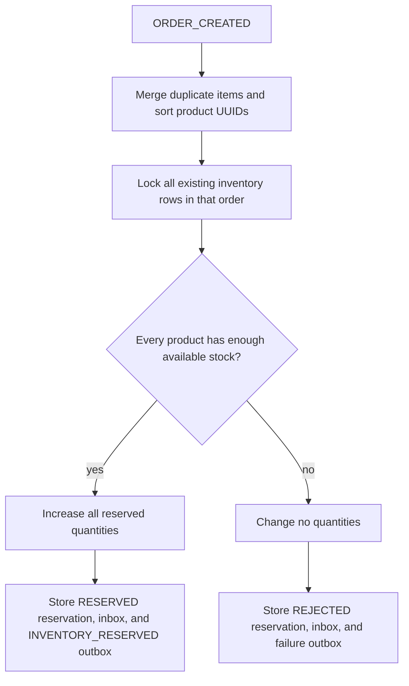

# Inventory Consistency

Each inventory row stores `onHandQuantity` and `reservedQuantity`.
`availableQuantity` is calculated, never stored:

```text
availableQuantity = onHandQuantity - reservedQuantity
```

Database checks require on-hand and reserved quantities to be nonnegative and
reserved quantity not to exceed on-hand. Manual adjustments lock the product
row and may not reduce on-hand below reserved stock.



The business transaction locks all involved rows using PostgreSQL
`PESSIMISTIC_WRITE`. Stable UUID ordering bounds deadlock risk when orders
contain the same products in different sequences. Redis locks and Java
`synchronized` are not correctness controls.

One reservation exists per order. Duplicate event IDs are ignored through the
processed-event table; an existing order reservation also prevents applying a
second event ID twice. Cancellation locks the reservation and product rows,
decrements reserved stock once, and marks it `RELEASED`. Rejected or
cancel-before-reserve cases publish a safe no-stock release result so order
cancellation can finish.

Reservations have a configurable expiry. The optional bounded poller uses
`FOR UPDATE SKIP LOCKED`, releases due rows, and emits `INVENTORY_RELEASED`
with reason `RESERVATION_EXPIRED`. A later scheduling phase may improve
cross-instance orchestration, but multiple current instances cannot claim the
same locked row concurrently.

## Paid inventory and fulfillment

`PAYMENT_SUCCEEDED` causes order-service to request `INVENTORY_COMMIT_REQUESTED`.
Inventory locks the reservation and transitions `RESERVED` to `COMMITTED`,
then acknowledges `INVENTORY_COMMITTED`. Order-service requests delivery only
when that acknowledgement arrives for a paid order. If commitment is no longer
possible, inventory emits a release reason that triggers payment compensation.

Only `RESERVED` reservations expire. `COMMITTED` reservations retain their
reserved quantity until pickup or cancellation. `DELIVERY_PICKED_UP` deducts
both on-hand and reserved quantity, then marks the reservation `FULFILLED`.
Duplicate pickup events cannot deduct stock again. Cancellation or failure
before pickup releases reserved stock; cancellation after pickup never restores
physical stock. Delivery returns require a separate business workflow.
