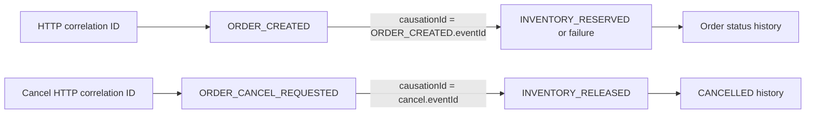

# Kafka Event Contracts

`event-contracts` contains immutable Java records and no Spring dependency.
Every event has metadata containing an event ID, enum type, integer version,
aggregate type/ID, occurrence time, correlation ID, nullable causation ID, and
producer.

| Topic | Producer | Event types |
| --- | --- | --- |
| `orderflow.order-events.v1` | order-service | `ORDER_CREATED`, `ORDER_CANCEL_REQUESTED` |
| `orderflow.inventory-events.v1` | inventory-service | `INVENTORY_RESERVED`, `INVENTORY_RESERVATION_FAILED`, `INVENTORY_RELEASED` |
| `orderflow.order-events.v1.DLT` | inventory retry recovery | Invalid order events |
| `orderflow.inventory-events.v1.DLT` | order retry recovery | Invalid inventory events |

The Kafka message key is always the order UUID, keeping one order's events on
one partition. Payloads use JSON and typed records; no native Java
serialization, bearer token, cookie, profile, or persistence entity is sent.
The `eventType` and `eventVersion` headers duplicate useful routing metadata.

Version 1 is the only supported version. Consumers require the expected type
and exact supported version. Additive compatible fields should retain their
names; a breaking change requires a new contract version and consumer rollout.
Unsupported versions and malformed JSON are retried twice and then published
to DLT rather than discarded.
