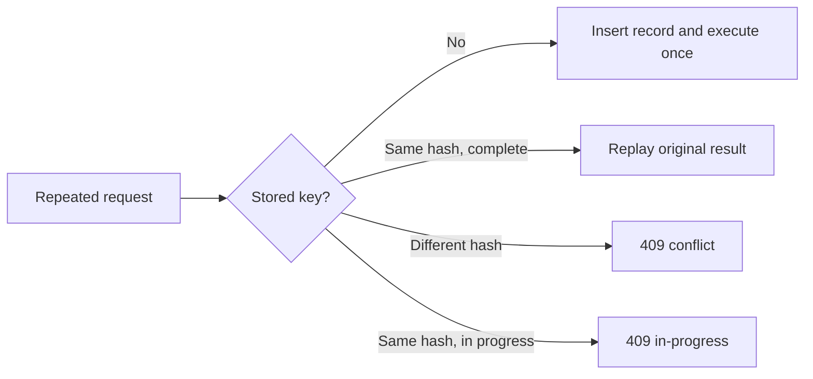

# Payment idempotency

Four distinct controls handle four distinct duplication sources:

| Boundary | Durable key | Risk addressed |
| --- | --- | --- |
| HTTP confirmation/cancel/refund | scope + actor + `Idempotency-Key` | client retry and concurrency |
| Provider call | stable operation reference | duplicate external charge/refund |
| Kafka consumer | event ID + consumer name | at-least-once message delivery |
| Webhook | provider + provider event ID + payload hash | provider retry and replay conflict |

HTTP request hashes use normalized operation input. Opaque tokens are included
only through one-way hashing and are never persisted. Same key/same request
replays the original status and resource; same key/different request returns
409. PostgreSQL uniqueness is the concurrency authority.

These controls complement rather than replace the outbox. Duplicate outbox
publication remains possible and is rendered harmless by consumer ledgers.
