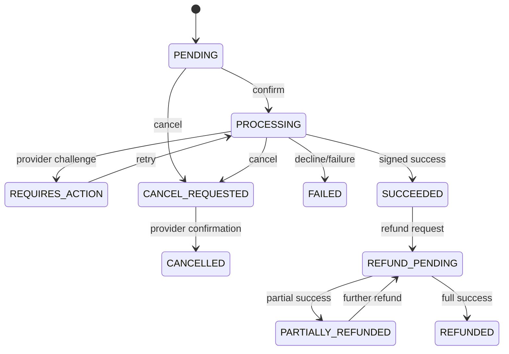
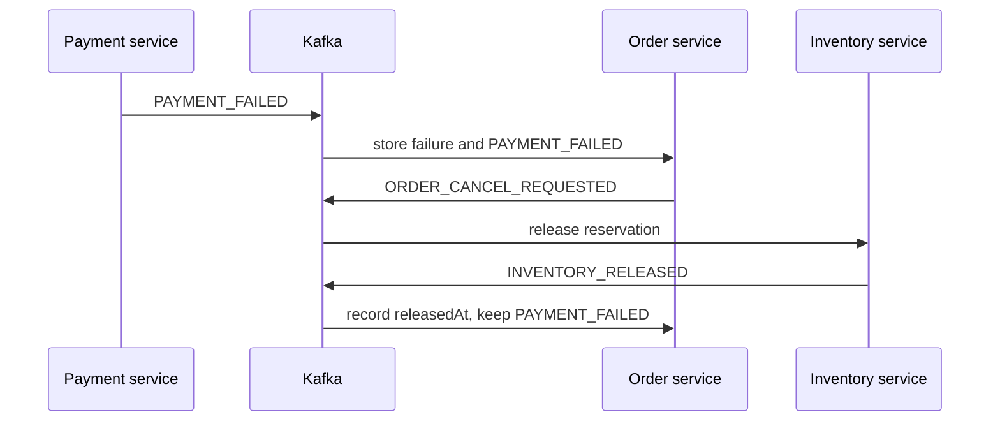

# Payment lifecycle

Each provider confirmation creates a numbered attempt without persisting the
opaque token. Success and failure webhooks update the latest attempt. A failure
after success is ignored; duplicate terminal webhooks are idempotent. A failed
payment may enter processing only through a new attempt.

Order states are monotonic: `PAYMENT_PENDING` becomes `PAID`,
`PAYMENT_FAILED`, or cancellation. Paid orders become partially or fully
refunded. Refunds do not change inventory.
