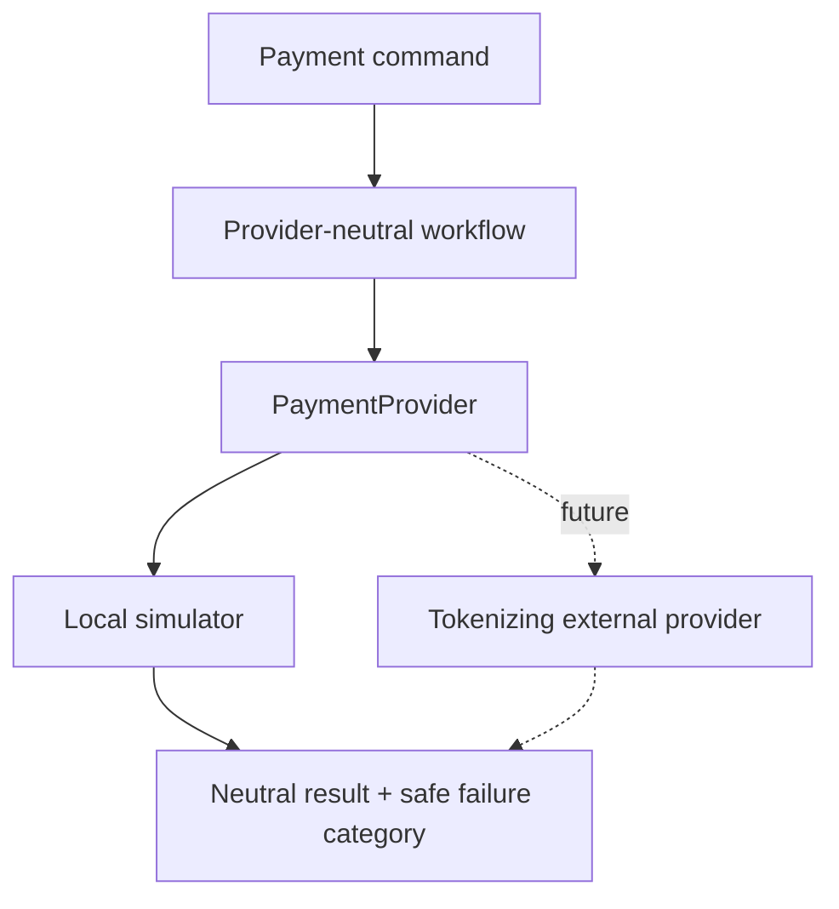

# Payment provider abstraction

Core workflows depend on `PaymentProvider`, provider-neutral request/result
records, and stable failure categories. The current adapter is a deterministic
local simulator. A future real adapter can be added without placing
provider-specific types in controllers, entities, order events, or order data.

Registration, confirmation, cancellation, and refund calls carry provider
idempotency references and run through named Resilience4j circuit breakers.
Only temporary/network/timeout classes are eligible for future bounded retry;
declines and validation failures are permanent.

The tokenization boundary is intentional. OrderFlow accepts an opaque token
created by a provider-owned payment UI or test fixture. It never accepts or
stores a card number, CVV/CVC, expiry fields, or bank credentials. The local
simulator demonstrates workflow behavior, not PCI compliance or production
payment processing.
