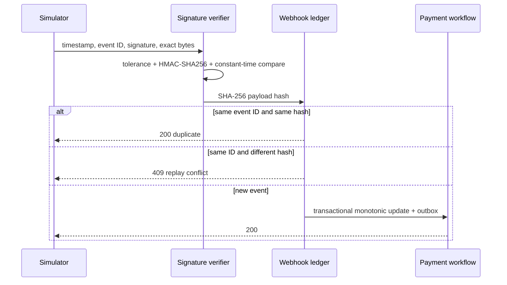

# Payment webhook security

The exact `POST /api/payments/webhooks/simulator` route is public because
providers do not possess customer JWTs. Public routing does not mean trusted
input: payment-service authenticates the provider message itself.

The signing input is `timestamp + "." + rawRequestBody`. Timestamps default to
a five-minute tolerance. Signature verification happens before JSON parsing.
Only the payload hash is stored; complete raw bodies, signatures, and secrets
are neither stored nor logged. Missing, malformed, stale, or invalid headers
receive a safe standard error.
