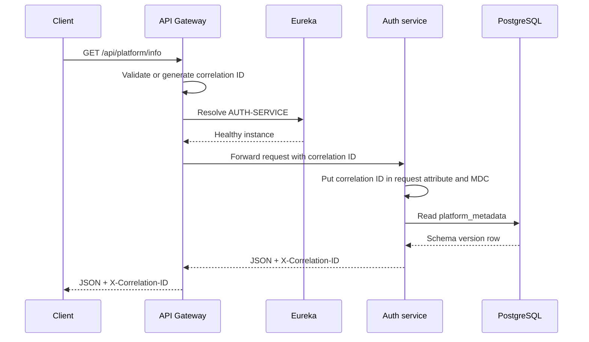
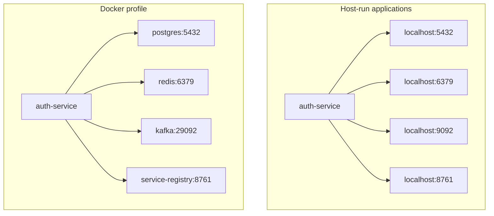
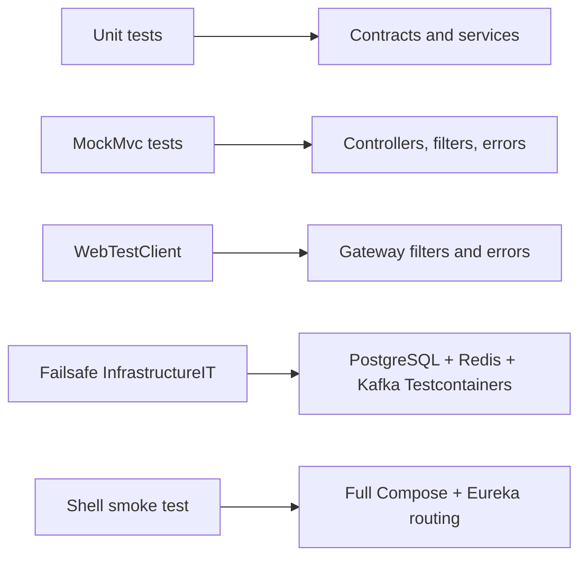

# Phase 1 architecture

## Request flow and routing

The gateway declares the two public path families in configuration and resolves
`lb://AUTH-SERVICE` through Spring Cloud LoadBalancer and Eureka. Automatic
discovery-locator URLs are disabled so registry names do not accidentally become
public API paths.

Both `auth-service` and `api-gateway` register with Eureka. The registry does not
register with or fetch from itself. Local profile settings shorten eviction and
disable self-preservation for developer feedback; the shared default retains
safer Eureka behavior.

## Networking profiles

Kafka advertises two listeners: `localhost:9092` for host applications and
`kafka:29092` for Compose services. KRaft supplies controller quorum without
ZooKeeper.

## Data and infrastructure ownership

PostgreSQL is the auth service's database boundary. Flyway owns schema change
history and creates `platform_metadata`; Hibernate is strictly set to `validate`.
The controller reads a response DTO through a service and repository, never the
JPA entity itself.

Redis and Kafka were connected foundations in Phase 1. Phase 2 now uses Redis
for security state; Kafka remains optional and noncritical for authentication.

Named Compose volumes preserve PostgreSQL, Redis, and Kafka data between normal
shutdowns. The explicit clean script removes only this project's containers and
volumes.

## Health and observability

All applications expose health, liveness, readiness, info, metrics, and
Prometheus endpoints. In Phase 2 the auth service readiness group combines
Spring readiness state with PostgreSQL and Redis. Kafka availability does not
block login. Liveness avoids external dependencies so a dependency outage does
not cause an unhealthy restart loop.

Spring Boot structured logging emits JSON console records with timestamp, level,
service, logger, thread, message, and available MDC fields. Gateway and MVC
completion filters add method, path, status, duration, event name, service, and
correlation ID. Completion logging is attached to terminal/finally behavior so
failures are logged once without recording request or response bodies.

## Correlation propagation

The shared validator trims and restricts incoming IDs to a safe 128-character
alphabet. The gateway mutates the downstream request, response header, exchange
attributes, and Reactor context. The auth filter revalidates the value, stores it
as one shared request attribute, enters it into MDC, adds the response header,
and clears MDC in `finally`. Controllers only read the established request
context and never generate competing identifiers.

## Error boundaries

The shared `ApiError` record supplies one immutable client contract. Gateway and
MVC handlers map known failures to stable codes and generic messages. Unexpected
exceptions may be logged with a server-side stack trace but client JSON never
contains internal messages, class names, SQL text, or stack traces. Validation
errors omit rejected values to avoid returning secrets.

## Testing strategy

Surefire runs focused unit and web-layer tests. Failsafe runs `*IT` classes during
`verify`; the integration test uses isolated containers and never a developer
database. Docker-less environments skip only that container-dependent class.
The smoke script tests the deployed request path and Eureka registration.
