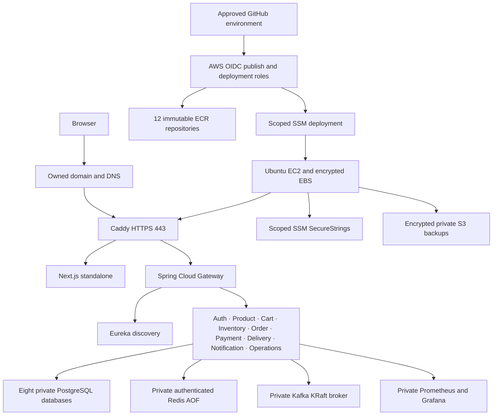

# Phase 10 — AWS cloud deployment

The repository now contains an AWS single-server deployment, release automation and local verification tooling. **No AWS resources, DNS changes or public deployment have been performed.** The proposed region is `us-east-1`; the AWS account, owned domain and spending approval are still required. Local simulation results are recorded separately in [phase-10-readiness.md](phase-10-readiness.md).

## Architecture



Default proposal: Ubuntu 24.04, x86_64 `t3.xlarge` (4 vCPU/16 GiB), 30 GiB encrypted gp3 root disk and 100 GiB separately retained encrypted data disk. The data disk mounts at `/opt/orderflow`; configuration, signing keys, data, release metadata and backups survive ordinary image replacements. Architecture and sizes are configurable. The instance uses IMDSv2 and Session Manager; inbound security-group ports are only 80/443. No SSH, NAT gateway, load balancer or managed database is part of the default proposal.

The eleven Java services, frontend, Caddy, PostgreSQL, Redis and Kafka share one host. This has single points of failure and planned release downtime. Compose provides health checks and restart policies, not rolling releases or enterprise HA. Capacity must be measured on the approved EC2 instance; local validation is not a production capacity benchmark.

## Terraform and state

[Infrastructure](../infrastructure/terraform/README.md) defines VPC/subnet/IGW/routes, security group, Ubuntu EC2, encrypted retained EBS, instance IAM/SSM, twelve immutable ECR repositories, GitHub OIDC roles, private encrypted/versioned S3 storage and opt-in DNS/EIP/budgets/alarms. Terraform pins the tested 1.16.5 line and AWS provider 6.68.x; the generated lockfile includes verified Linux AMD64/macOS ARM64 checksums.

```sh
cd orderflow/infrastructure/terraform
terraform fmt -check -recursive
terraform init -backend=false -lockfile=readonly
terraform validate
terraform test
```

Mocked Terraform tests exercise security/account/DNS/IAM policies without contacting AWS. They are not a real account plan. Terraform requires an explicit account and checks the authenticated account. Human authorization is required before billable provisioning; no Terraform boolean substitutes for that approval. Real `plan`, `apply` and `destroy` remain unexecuted. See [AWS setup](aws-setup.md) for the reviewed bootstrap/install/state steps and an example S3 backend with versioning, encryption and native state locking. A new state bucket also requires approval. Real state, plans and populated tfvars are ignored; secrets are supplied outside Terraform.

## Runtime, secrets and HTTPS

[Cloud configuration](cloud-configuration.md) uses the base Compose file plus `docker-compose.cloud.yml`. The override removes local builds, public internal ports and development credential defaults. Every application image comes from a digest-pinned release manifest. Only Caddy publishes public web ports; monitoring is private or available through explicitly scoped loopback/SSM forwarding. PostgreSQL, Redis, Kafka, Eureka, the gateway, frontend and Actuator administration have no direct public ports.

Caddy routes `/api/**`, `/oauth2/authorization/**` and `/login/oauth2/code/**` to the gateway. Next.js retains page routes, including `/oauth2/success` and `/oauth2/failure`. Request forwarding headers are sanitized at Caddy. A dedicated edge alias ensures gateway traffic arrives from the configured physical Caddy IP; the gateway accepts a single literal client IP only from that peer. HTTPS origin/issuer/callbacks, secure refresh/CSRF cookies, rate limiting, JWT revocation, ownership and CSRF remain enabled. Gateway payment-confirmation limiting uses the actual `/api/payments/orders/{orderId}/confirm` route.

Cloud frontend builds set `NEXT_PUBLIC_API_BASE_URL=` so browser calls use the same public origin. These public values are build-time configuration, not secrets. Internal gateway DNS is never a browser-facing URL. All Java builders use the native build platform to compile portable Java 21 bytecode; `docker buildx --platform` selects the runtime architecture. The frontend is built for its target platform, including native Node dependencies. Packaging skips tests only after the complete quality gates have passed.

[Secrets management](secrets-management.md) retrieves five scoped SecureStrings through the instance role: runtime environment, persistent private/public signing key files, backup encryption key and protected operator journey accounts. Files are never printed. JWT mounts use explicit `file:/run/secrets/...` resource URIs; the non-root auth runtime is UID/GID 10001 and files are mode0400. Regular deployment rejects changed key material instead of silently regenerating or rotating it. The current application publishes one active verification key; seamless overlapping rotation needs additional implementation. A separately authorized disruptive rotation must account for access-token expiry, refresh sessions and revocation.

[HTTPS/domain setup](https-and-domain.md) supports an owned external DNS provider or an explicitly enabled existing Route 53 zone. The domain must resolve to the approved host; 80/443 must be reachable and Caddy certificate storage persists. Public DNS, trusted ACME issuance and actual OAuth provider callbacks have not been verified. No domain was purchased and no DNS record was modified.

## Simulator and demo accounts

**DEMO PAYMENT — NO REAL MONEY CHARGED.** Email and SMS remain simulated. No card details, external payment credentials or real transactions are used. The cloud-demo worker is disabled by default and excluded from `prod`/`production`. It polls bounded eligible processing records and submits signed callbacks to the existing loopback webhook endpoint. Normal signature, idempotency, ledger and outbox checks perform the financial change; no browser signing secret or unsigned completion endpoint exists. Declines and action-required outcomes do not become successful merely because a request was accepted.

Public registration grants only CUSTOMER. VENDOR, DELIVERY_AGENT and ADMIN operator test accounts live in a private credential file; administrator passwords are never advertised. The opt-in [synthetic seed](../scripts/cloud/seed_demo.py) registers exact fake identities, uses a separate trusted-host approval to grant fixed roles in the auth database, and creates fake category/product/initial stock through normal APIs. Reruns preserve existing stock and records. It adds no public role-promotion endpoint and does not create orders in existing visitors' accounts.

## CI/CD and release procedure

Root `.github/workflows/ci.yml` preserves the full Java/frontend gates and adds Terraform, effective cloud Compose, Caddy, deployment/backup/journey safety and monitoring checks. `build-images.yml` reuses CI, then publishes all twelve selected-platform exact-SHA images through the scoped `cloud-demo-publish` OIDC role and environment approval. `release.yml` orchestrates image release without duplicating full builds. `deploy.yml` is manual, requires the protected `cloud-demo` environment, validates the successful trusted artifact producer, checks account/manifest/archive integrity and performs bounded SSM deployment.

[CI/CD instructions](cloud-ci-cd.md) list environment variables and approval settings. These workflows have only been checked locally; remote execution of the new workflows is **NOT RUN** during the original preparation assessment; subsequent Git publication was separately authorized with a maximum of 13 commits. Environment protection/allowed branches must be configured in GitHub before cloud release.

The immutable release contains twelve image digests, exact Git SHA/platform/account/region/version, reviewed schema compatibility and migration hashes. Archive validation rejects traversal, links, duplicate/special/oversized members and mismatched embedded manifests or SQL. The host refuses to overwrite an existing immutable release directory.

A release validates target identity, required secrets/key pair, capacity and Compose; takes a predeploy backup; pulls exact images and verifies architecture; preserves previous healthy metadata; starts services; waits for readiness; checks real Eureka registration/gateway/frontend/TLS; and runs the authenticated critical journey plus outbox/DLT checks before recording health. All waits are bounded. A startup or hook failure leaves the previous healthy record intact and returns failure. See [deployment runbook](runbooks/cloud-deployment.md).

Rollback selects a recorded healthy immutable release, checks schema compatibility, backs up the current schema/data and recreates the prior application image set. It does not restore old database contents. Newest schema metadata remains authoritative even after an application rollback. Non-backward-compatible migrations require a separate reviewed recovery decision. See [rollback runbook](runbooks/cloud-rollback.md) and [release checklist](cloud-release-checklist.md).

## Data, backup and recovery

PostgreSQL has eight distinct nonprivileged application owners; bootstrap is idempotent and does not DROP/recreate databases on release. Flyway migrations remain append-only and JPA validates schema. Redis authentication/AOF preserves carts, revocation and rotation state subject to its persistence limits. Kafka KRaft uses persistent private broker storage and existing topics/groups/outbox contracts. One broker and local Redis do not provide HA.

[Backup/restore tooling](cloud-backup-restore.md) creates timestamped dumps of all eight databases, release SQL/Flyway metadata, checksums and an authenticated encrypted archive. Optional S3 uses the instance role, private storage and server-side encryption. Retention is explicit. Restore tooling only creates an isolated disposable database environment; it cannot target the live database. The real local restore exercise verified schema/data, owner password authentication/privileges, Flyway SQL checksums/history, counts and representative hashes. Application startup against restored databases, live recovery and AWS snapshot restores remain unexecuted. Recovery instructions and unmeasured RPO/RTO assumptions are in [disaster recovery](cloud-disaster-recovery.md).

## Monitoring and logs

[Cloud monitoring](cloud-monitoring.md) reuses the eleven service Prometheus targets and Grafana dashboards, adds private frontend/gateway/Caddy availability and host/disk monitoring, and includes outbox/DLT/simulator/backup alerts. Prometheus and Grafana administration are not public application ADMIN features. Full release verification requires the monitoring profile and a private Prometheus endpoint; missing targets/gauges or new DLT growth fail the gate. Lazy DLT counters are interpreted only with confirmed stable healthy service scrapes.

Docker/Caddy logs are bounded. Caddy access records omit request URI/query and headers; runtime errors cannot leak signed callback headers or auth cookies. Application structured logging and correlation IDs remain in place. External alert delivery, CloudWatch ingestion and AWS alarms/budgets are opt-in and require authorized configuration; no real notification recipient has been configured.

## Tests and local simulation

The readiness report lists the exact executed commands/counts. Local checks include complete Java/frontend suites, mocked Terraform policy tests, effective Compose security policies, actual Caddy routing/forwarding/SSE/body/log behavior, actual PostgreSQL bootstrap and isolated encrypted backup/restore, workflow/actionlint and source-secret checks. All twelve application images built and were inspected for both Linux AMD64 and ARM64. Local full-stack execution used native ARM64.

The executed dependency scan found new advisories beyond the original Boot3.5-managed versions. Compatible Tomcat/Netty/FreeMarker/Apache HTTP updates reduced twenty threshold findings to seven remaining Spring findings. The owner chose to keep Boot3.5 and document them. [Security review](cloud-security-review.md) distinguishes vendor preconditions from scanner scores; the raw CVSS9 gate remains enforced and publication is blocked. Passing functional tests does not clear this gate.

The isolated full-stack simulation uses fresh local data, fake accounts, Caddy's local CA and explicit test memory overrides. Startup, HTTPS routing and auth-key restart checks passed, but complete browser attempts failed under the 4 GiB Docker VM's memory pressure. The actual API hook refused its unhealthy-scrape preflight before API writes. The owned fixture is stopped with its data retained. Cloud budgets now reserve half of each Java container for native memory and 3.5 GiB of the proposed 16 GiB host outside container limits; those definitions are policy-tested, while EC2 capacity is unmeasured. Its localhost HTTPS results do not prove public certificate trust, EC2 capacity or AWS reachability. Deployed browser verification supports `E2E_BASE_URL` and only explicitly authorized demo/staging targets. Public HTTPS certificate validation stays enabled; the local certificate exception is restricted to an explicit localhost simulation. The API verification hook checks a real streamed notification against owned persisted data when executed successfully; its complete business/SSE result is not credited as PASS here.

The modest performance tool caps requests at30 and concurrency at2, reports success/failure counts and p50/p95/p99, and requires the same explicit target authorization. It does not establish production-scale throughput. See [testing commands](cloud-configuration.md).

## Cost and authorization boundary

[Cost worksheet](cloud-cost-management.md) provides current official source links and a clearly illustrative `$137.02/month` planning subtotal for 730 compute/IP hours, 130 GiB gp3 and assumed15 GB ECR storage. It is not a live verified account/SKU quote or complete bill: S3/state/snapshots, requests, transfer, DNS/domain, optional KMS/monitoring and taxes remain additional/unverified. Budget alerts do not enforce a hard cap; stopped instances can retain billable storage/address resources.

Before provisioning, supply the intended AWS account/region, authorized role or SSO access, an owned domain/DNS access, explicit approval for the reviewed resource plan and a spending budget. Confirm existing resources for safe reuse, actual price assumptions, GitHub environment protection and SecureString provisioning. Only then may an approved real plan/apply, DNS change, ECR publication, SSM deploy and public HTTPS journey be executed. Until then there is no live-demo URL.
