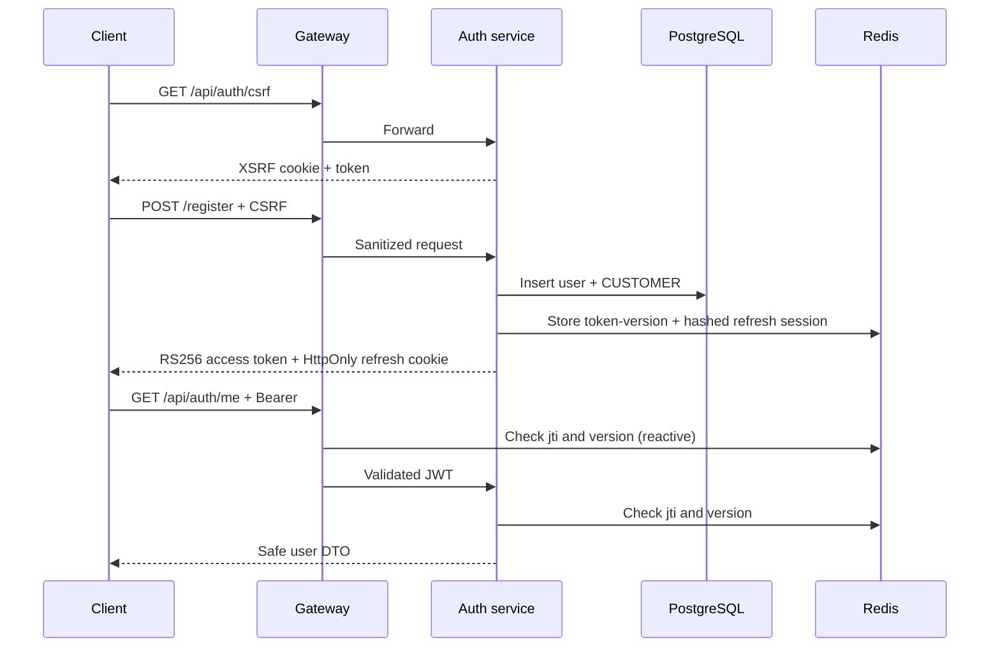

# Phase 2 authentication and authorization

## Boundary

Phase 2 owns user identity only. `users`, `user_roles`, and `oauth_accounts` are
created by Flyway V2 in the auth database. Email uniqueness and normalization
are protected by database constraints; Hibernate validates rather than creates
the schema.

The gateway is the first enforcement boundary and the auth service is the
second. Both validate RS256, issuer, timestamps, required claims, `jti`
revocation, and `token_version`. The auth service additionally applies exact
`@PreAuthorize` role rules. Redis uncertainty fails protected requests closed.

## Request flows

Registration and login produce a distinct session/family and an access token.
Refresh atomically consumes the current refresh state and creates a replacement.
Logout blacklists one access token and refresh session. Logout-all increments
the user's version and revokes all indexed refresh sessions.

## Roles and endpoints

New self-registered and OAuth users receive only `CUSTOMER`. Supported roles are
`CUSTOMER`, `VENDOR`, `DELIVERY_AGENT`, and `ADMIN`. `ROLE_` authorities are
derived only from the signed `roles` claim. `/api/security/customer` permits
customer or admin; `/api/security/admin` permits admin.

The optional admin bootstrap is disabled by default, contains no default
credentials, validates every required value, hashes the password with BCrypt,
and creates a user only when the normalized email is absent.

## CSRF, audit, and errors

Unsafe browser requests require matching `XSRF-TOKEN` and `X-XSRF-TOKEN` values
at both boundaries. The refresh cookie is HttpOnly and cannot supply the CSRF
header. Authentication and authorization errors use `ApiError`, generic
messages, and the established correlation ID.

Security events include registration, login success/failure/throttling, refresh,
reuse, logout, OAuth, denial, and rejected-token events. Only safe identifiers,
hashed client attributes, reason codes, and correlation IDs are recorded.
Authentication never depends on Kafka availability.
