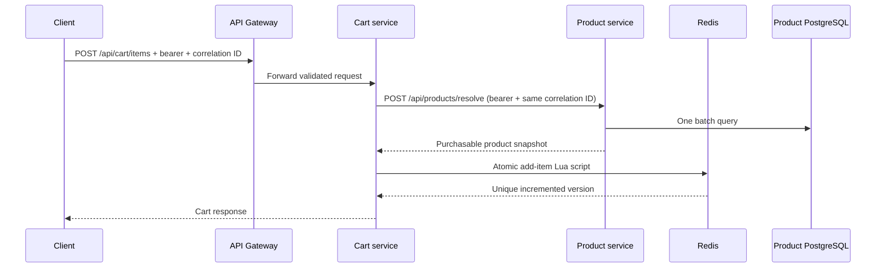

# Phase 3: Product Catalog and Cart

Phase 3 introduces `product-service` and `cart-service` behind the existing
reactive gateway. It preserves Phase 2 identity: services validate the same
RS256 issuer and JWK set, then independently check Redis revocation and token
version state.



## Security boundaries

- Public access is limited to catalog GETs, platform endpoints, auth entry
  points, and required actuator endpoints.
- Resolution and cart APIs require any authenticated active user.
- Vendor management requires `VENDOR` or `ADMIN`; category administration
  requires `ADMIN`.
- Product ownership and cart identity are derived from the JWT subject.
- A vendor receives 404 when trying to manage another vendor's product, avoiding
  disclosure of private ownership. Clear role denial returns 403.
- Product and cart services do not depend on auth implementation classes or
  query auth tables.

## Availability boundaries

Product-service treats PostgreSQL as authoritative and Redis as an optional
cache, so product readiness includes the database but excludes Redis. Cart
storage is Redis-authoritative, so cart readiness includes Redis. Product
availability is not a cart-readiness dependency because stored snapshots remain
readable without product resolution.

Cart product calls use discovery/load balancing, limited temporary-failure
retry, circuit breaking, and explicit connect/read timeouts. Add, update, and
validation fail with a safe 503 when current product facts cannot be obtained.

## Verification

`ProductCatalogIT` uses PostgreSQL and Redis Testcontainers. `CartFlowIT` uses a
Redis container and a local product HTTP stub, including concurrency, TTL,
header propagation, batch validation, and failure mapping. MVC tests exercise
service security and the gateway remains fully reactive. Run:

```bash
./mvnw -B clean verify
docker compose config
./scripts/dev-up.sh
./scripts/smoke-test.sh
```

No inventory, reservations, order, checkout, payment, product media, or Kafka
business workflows are included; they remain Phase 4 concerns.
