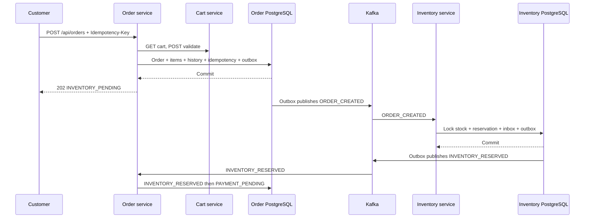

# Phase 4: Orders, Inventory, and Reliable Events

Phase 4 adds inventory-service, order-service, and the framework-light
event-contracts module. It keeps database ownership strict while coordinating
the order lifecycle through versioned Kafka events.



Order requests cannot submit customer IDs, products, quantities, prices, or
totals. Order-service derives the customer from the JWT, gets the authoritative
cart over the service API, and recalculates all `BigDecimal` totals. Item
snapshots become immutable after creation. The cart is not cleared in Phase 4.

Inventory management requires `VENDOR` or `ADMIN`. Inventory-service asks
product-service whether the authenticated actor may manage the product;
reservation consumers never make this synchronous call. PostgreSQL remains the
stock source of truth.

Services independently validate RS256 JWTs and Redis revocation/token-version
state. Kafka consumers have no user token and instead validate typed event
shape, event type, version, aggregate identity, and idempotency.

Run all verification with:

```bash
./mvnw -B clean verify
docker compose config
./scripts/dev-up.sh
./scripts/smoke-test.sh
```

Payment authorization, payment completion/failure, refunds, provider
integration, and post-payment cart handling are deferred to Phase 5.
