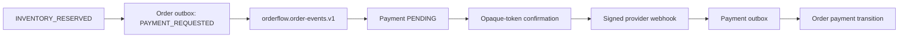

# Phase 5 payments

Phase 5 introduces payment-service on port 8086 and the isolated
`orderflow_payment` database. It consumes payment commands from the order topic
and emits payment outcomes through `orderflow.payment-events.v1`. Neither
service reads the other's database.



Customer APIs support safe queries, bounded attempt history, confirmation, and
cancellation. Admin APIs support bounded search, safe details, and partial/full
refunds. Responses omit provider secrets, raw payloads, tokens, and JPA
versions. A non-owner sees 404.

The simulator tokens are `tok_success`, `tok_declined`,
`tok_requires_action`, `tok_timeout`, and `tok_temporary_failure`. Raw PAN,
CVV/CVC, expiry, or bank credential input is deliberately unsupported. The
simulator must be explicitly enabled and startup fails when it is selected in
the production profile without a deliberate override.

All business events use an order ID key, immutable v1 contracts, correlation
and causation metadata, a transactional outbox, bounded publication retry, and
an inspectable DLT. This provides at-least-once delivery; it does not claim
exactly-once delivery.

Local usage:

```bash
./scripts/dev-up.sh
./scripts/smoke-test.sh
./scripts/dev-down.sh
```

`.env.example` contains only local placeholders. Do not commit `.env`, real
provider credentials, webhook secrets, tokens, cookies, or private keys.
