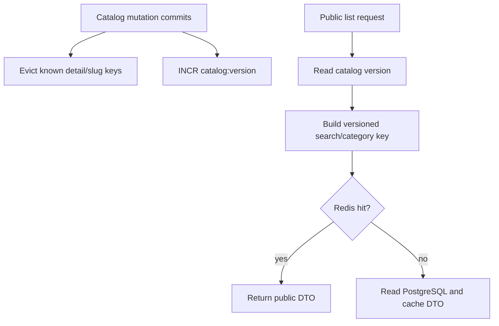

# Redis Catalog Caching

Product-service uses Spring Cache with JSON Redis values and no null caching.
The namespace includes application cache version `orderflow:catalog:v1`.
Default TTLs balance staleness and database load:

| Cache | Default TTL |
| --- | ---: |
| Product detail and slug | 5 minutes |
| Product search | 2 minutes |
| Category list | 10 minutes |

Detail and slug entries contain only public product DTOs and are evicted by
known keys after a product mutation. Search and category keys include the value
of the exact Redis key `catalog:version`; every committed catalog mutation
increments it. Old list entries expire naturally, so the implementation never
uses Redis `KEYS`, pattern scans, or broad deletion.

Cache access is best effort. Redis errors increment safe metrics and are logged
without keys, credentials, tokens, or response data. Reads fall back to
PostgreSQL and cache failures never roll back a successful database mutation.
For that reason Redis is excluded from product readiness; PostgreSQL remains
required.

Metrics include search requests, cache hits/misses, and invalidations without
using product or user identifiers as tags.
