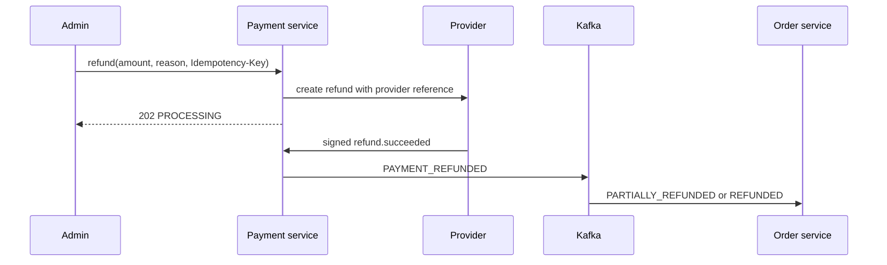
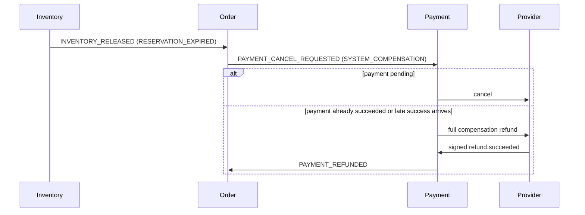

# Refunds and compensation

Admins may request an explicit positive refund amount up to the remaining
refundable balance. PostgreSQL locking and constraints prevent concurrent
over-refunds. Provider confirmation is asynchronous.

A failed refund never changes cumulative refunded amount and restores the
payment to `SUCCEEDED` or `PARTIALLY_REFUNDED`. Partial and full refunds do not
automatically restock inventory.

A cancellation tombstone handles the race where cancellation arrives before
payment creation. Late capture after cancellation or deadline expiry starts a
full `SYSTEM_COMPENSATION` refund instead of leaving money captured without
inventory.
