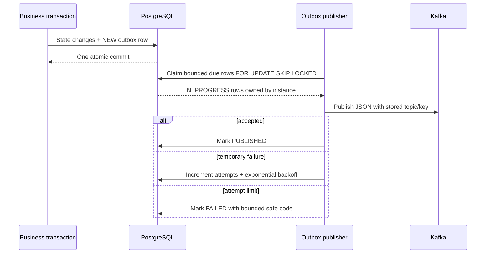

# Transactional Outbox

Publishing directly during a database transaction creates a dual-write
problem: PostgreSQL may commit while Kafka fails, or Kafka may accept a message
while PostgreSQL rolls back. Both Phase 4 services instead insert an outbox row
in the same local transaction as their business change.

Claims recover after a configurable lock timeout. Publisher batches, poll
delay, retry base delay, send timeout, and maximum attempts are configurable.
Failed rows remain inspectable. Backlog, failed count, publications, and
publication failures are exposed as low-cardinality metrics.

A crash after Kafka acceptance but before `PUBLISHED` can publish a row again.
The design therefore guarantees durable at-least-once intent, not exactly-once
delivery. Processed-event tables make duplicate delivery harmless.
